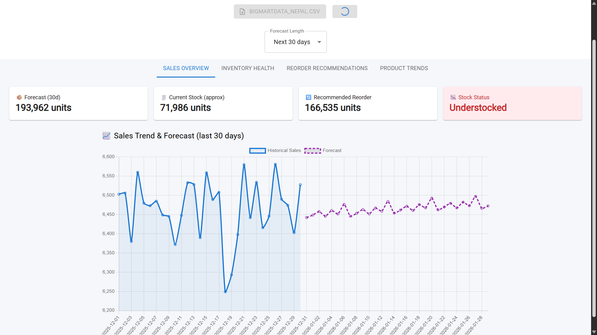

# Smart inventory forecast

A web dashboard that turns a retailer's sales history into a demand forecast, a stock-health status and a reorder suggestion. Upload a CSV of daily sales and stock, and the app shows sales trends, a forecast for the chosen horizon and how much to reorder.



## How it works

1. **Upload.** The FastAPI back end accepts a CSV and detects the date, product, units-sold and stock columns by name.
2. **Forecast.** Daily sales are forecast for 1–365 days with Prophet (yearly and daily seasonality) when it is installed, and with the recent daily average otherwise.
3. **Stock status.** Each product is labelled from its current stock, forecast demand over the horizon and a safety stock:

| Status | Rule |
|---|---|
| Understocked | Current stock < forecast demand |
| Low stock | Forecast demand ≤ current stock < forecast demand + safety stock |
| Healthy | Current stock ≥ forecast demand + safety stock |

4. **Reorder.** Reorder quantity = forecast demand + safety stock − current stock (never below zero), and reorder point = average daily sales × lead time + safety stock.

The back end also contains a multivariate forecaster (random forest on lag and calendar features) and a helper with Nepali holiday dates (Dashain, Tihar, New Year) prepared for adding holiday effects to Prophet; it is not yet connected to the forecast.

## Stack

| Part | Technology |
|---|---|
| Back end | Python, FastAPI, pandas, NumPy, Prophet, scikit-learn |
| Front end | React, Material UI, Chart.js |
| Deployment | Docker Compose (back end on port 8000, front end on port 3000) |

## Run

With Docker:

```bash
docker compose up --build
```

Then open http://localhost:3000.

Without Docker:

```bash
cd backend
pip install -r requirements.txt
uvicorn app.main:app --port 8000
# in a second terminal
cd frontend
npm install
npm start
```

## Data

`backend/data/uploads/` contains example files to try the app: a synthetic BigMart-style dataset with Nepali products, a retail store inventory dataset and Walmart weekly sales. The synthetic data is for demonstration only.

## Next steps

- Evaluate the forecasts on a held-out period (for example, mean absolute percentage error for the last 30 days) and compare Prophet with the moving-average and random-forest forecasters.
- Forecast per product rather than in total, and learn safety stock from forecast uncertainty.
